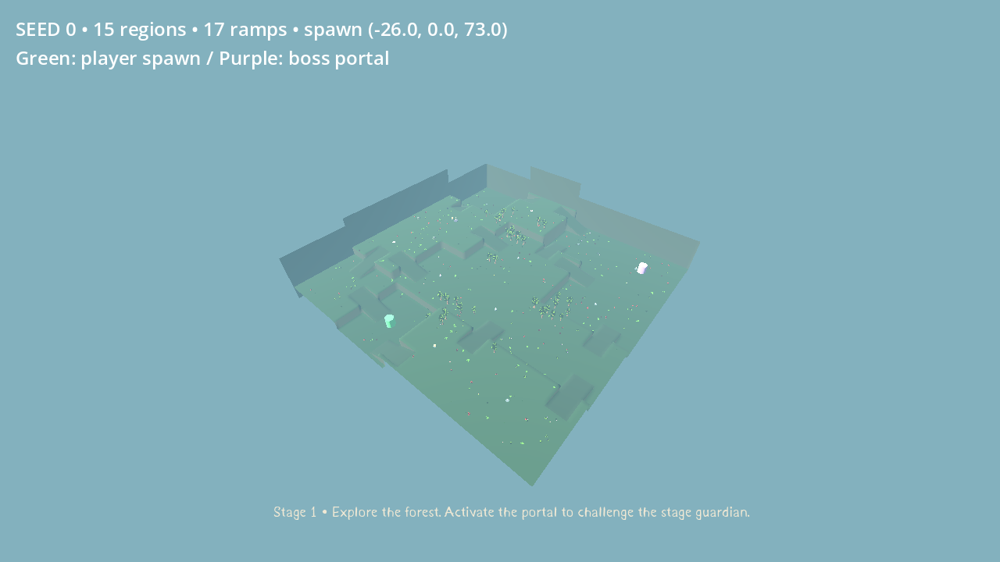
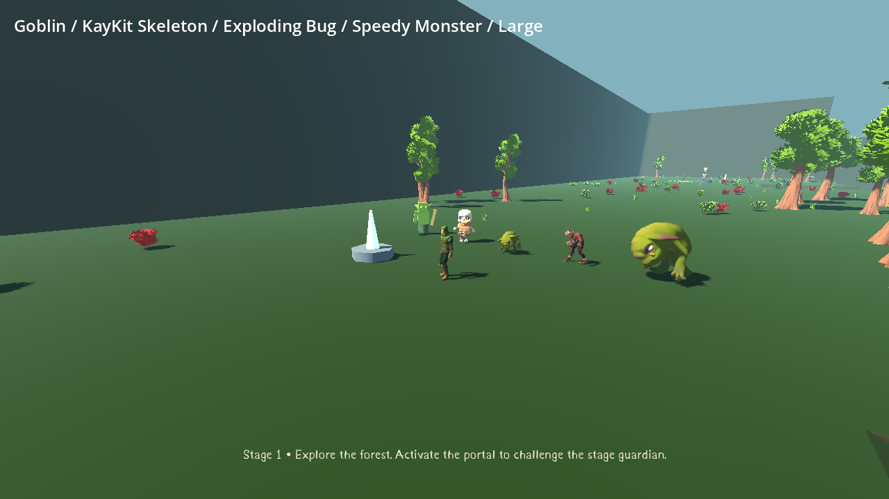
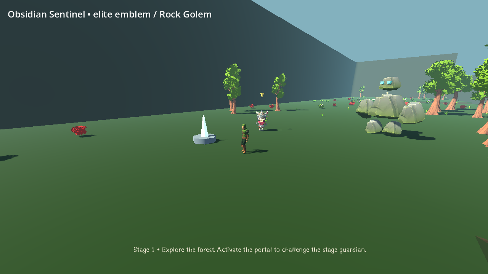

# MEGACLONK

A native Godot4.7.2 survival roguelike with ten-minute forest stages, player-triggered
boss encounters, continued runs, configurable loadouts and permanent silver progression.
This update adds staggered random terrain and peripheral spawns, corrected Ranger locomotion,
a three-category enemy roster, cliff climbing, one-use elite statues and two new main bosses.
[Current rules, assets and limitations](docs/DYNAMIC_FOREST.md).

## Download and play

- [Windows ZIP](https://github.com/Hazmire/MegaClonk/releases/download/dynamic-forest-v3.1/BONK_INFINITY_Windows_x64.zip)
- [GitHub Actions builds](https://github.com/Hazmire/MegaClonk/actions/runs/40246730637)
- [PR #3 — merge into Full-Release](https://github.com/Hazmire/MegaClonk/pull/3)

Extract and launch **BONK_INFINITY.exe**, or **Launch_Compatibility.bat** if Vulkan
is unavailable. The executable name and BONK INFINITY save folder remain for compatibility.
No engine installation/account/network is needed to play. Publication/source/checksums are
recorded in [BUILD_INFO](releases/BUILD_INFO.md). Native Windows execution remains untested.

## Play

Choose one weapon, one trait and one ultimate. Explore the forest for treasure, shops,
shrines and the purple boss portal. Rushes occur at08:00/04:00; minibosses at07:00/03:00.
At zero, endless ghosts and ordinary pressure escalate. Summon the boss whenever ready;
Big Chunkus marks a delayed AOE; Rock Golem summons capped lesser golems. Activate gold-marked
elite statues to fight three Sentinels for90 bonus gold. Defeat the boss, then enter the unlocked portal to generate a harder stage while retaining your build.

WASD move · mouse camera · Space jump/glide · Ctrl crouch/slide · E interact · Q ultimate
· Escape pause/save · Tab build/stats · wheel zoom · F11 fullscreen. Gameplay keys are rebindable.

All five traits and all three ultimates are available initially. Quests award permanent
silver; gold belongs to the current run. Silver unlocks weapons and independently upgrades
weapon/tome capacity from2 to4, costing250 then750 per category. Shops accept gold and
vanish after one successful purchase. Hover stats/equipment in Tab for rules and measured DPS.

[Full rules and controls](docs/CORE_OVERHAUL.md) · [Playtest guide](docs/PLAYTEST.md)





## Assets and limits

Runtime art includes Quaternius Ranger/UAL2/Nature/Bestiary, new KayKit Minion/Warrior skeletons,
existing icons, sounds and particles. Goblin is original geometry; Rock Golem is assembled from
supplied Nature rocks. [Credits](ASSET_CREDITS.md) and [current asset choices](docs/DYNAMIC_FOREST.md).
The supplied Bestiary has two species; no additional imported species are claimed.

## Development

```sh
python3 tools/install_engine.py
tools/validate.sh
tools/godot.sh --path .
tools/export.sh
```

Use writable BONK_TOOLS_ROOT and BONK_RUNTIME_ROOT on other Linux machines. CI installs
checksum-verified Godot/templates, imports committed assets, runs ten suites and exports
Windows x64. Ability/run balance Resources live in assets/config. Extraction of uploaded
archives is reproducible with tools/integrate_uploads.py (libarchive required for RAR);
CI uses the already committed runtime assets.

[Validation evidence](VALIDATION.md) · [Dynamic Forest checklist](TODO_DYNAMIC_FOREST.md) · [Current status](docs/STATUS.md).
Profiles migrate to V3 silver while preserving existing statistics, settings, unlocks and saves.
