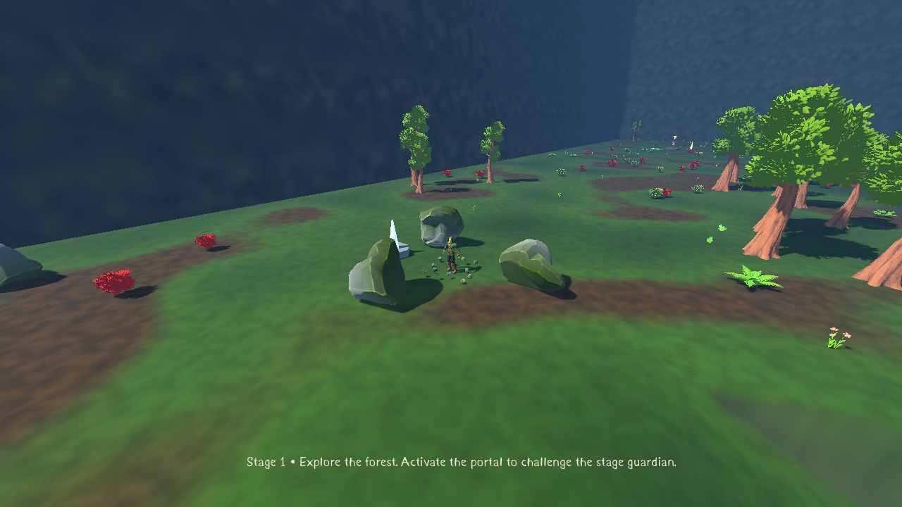
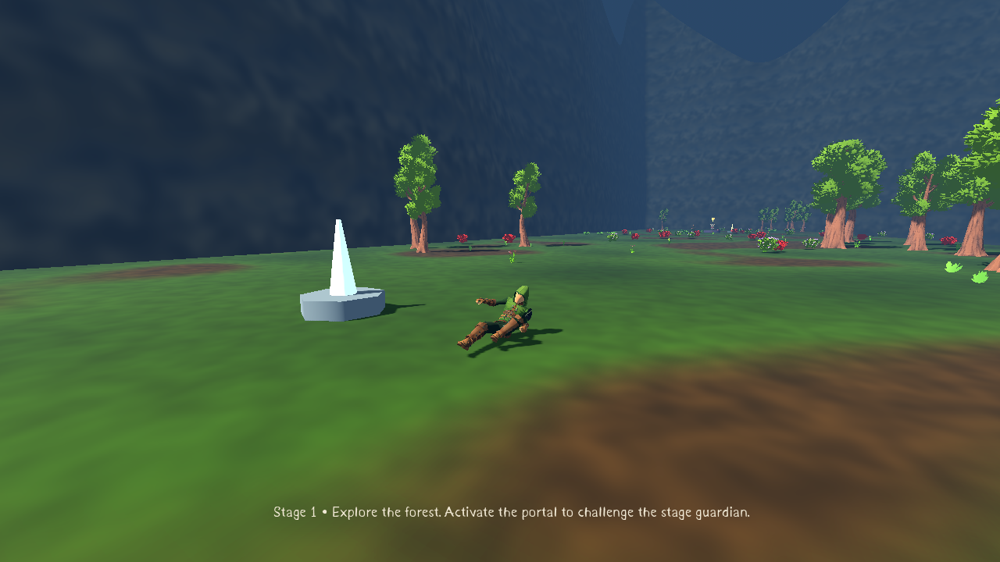

# MEGACLONK

A native Godot4.7.2 survival roguelike with ten-minute forest stages, player-triggered
boss encounters, continued runs, configurable loadouts and permanent silver progression.
The latest source adds a four-band vertical Forest, adaptive ramps, supplied HDR skies,
and constrained world-object placement, following the shared five-tier rarity foundation.
See [world guide and twelve previews](docs/VERTICAL_FOREST.md), [performance](docs/VERTICAL_PERFORMANCE.md),
and [reward UI and XP guide](docs/REWARD_UI.md).
The latest source also adds reference-based inventory/stats sidebars, stacked upgrades,
a slowing chest reel, shared shop/build screens and blue/red XP gemstones.

The GitHub reference images now also inform the [pause, expanded map and UI refinements](docs/REFERENCE_UI.md). Press **M** in a run to open the discovered-world map.

The latest source adds [stage themes, physical swarms, automatic shrines and multiplied bosses](docs/STAGE_SWARMS.md). The Windows playtest is published and its downloaded game pack has passed the world, reward/UI and stage/swarms checks. Dense-swarm performance remains a known limitation.

The latest source increment adds [shrine rarity choices, persistent reward effects, continuous pursuit and HUD/bug fixes](docs/REWARDS_AI_V9.md). The v9 Windows release is published and its downloaded game pack passed all four compiled smoke gates.

The art-reset update adds [ten active weapons, Common first acquisitions, supplied art, natural outer cliffs and route-aware red portal wind](docs/ART_RESET.md). [Rendered gallery and motion recording](docs/ART_RESET.md#rendered-gallery) · [asset inventory](docs/ART_RESET_ASSET_AUDIT.md) · [measured performance and limits](docs/ART_RESET_PERFORMANCE.md).

The retro-audio update adds [four original tracks, curated weapon/movement/reward audio, five saved volume sliders and white enemy feedback](docs/RETRO_AUDIO.md). The full Pixel Combat library stays outside the project.

The latest [dark-feedback update](docs/DARK_FEEDBACK.md) removes enemy hit/death sounds, darkens the effects and adds a separate tome row plus matching dark-red health bars with numbers.

## Download and play

- [Windows ZIP](https://github.com/Hazmire/MegaClonk/releases/download/dark-feedback-v12/BONK_INFINITY_Windows_x64.zip)
- [GitHub Actions builds](https://github.com/Hazmire/MegaClonk/actions/workflows/windows-build.yml)
- [PR #5 — merge into Full-Release](https://github.com/Hazmire/MegaClonk/pull/5)

Start a **new run** to see the new terrain; older checkpoints retain their original maps.
Extract and launch **BONK_INFINITY.exe**, or **Launch_Compatibility.bat** if Vulkan
is unavailable. The executable name and BONK INFINITY save folder remain for compatibility.
No engine installation/account/network is needed to play. Publication/source/checksums are
recorded in [BUILD_INFO](releases/BUILD_INFO.md). Native Windows execution remains untested.

## Play

Choose one weapon, one trait and one ultimate. Explore the forest for treasure, shops,
shrines and the red stone boss portal. Rushes occur at08:00/04:00; minibosses at07:00/03:00.
At zero, endless ghosts and ordinary pressure escalate. Summon the boss whenever ready;
Big Chunkus marks a delayed AOE; Rock Golem summons capped lesser golems. Activate gold-marked
elite statues to fight three Sentinels for90 bonus gold. Defeat the boss, then enter the unlocked portal to generate a harder stage while retaining your build.

WASD move · mouse camera · Space jump/glide · Ctrl crouch/slide · E interact · Q ultimate
· Escape pause/save · Tab build/stats · wheel zoom · F11 fullscreen. Gameplay keys are rebindable.

All five traits and all three ultimates are available initially. Quests award permanent
silver; gold belongs to the current run. Silver unlocks weapons and independently upgrades
weapon/tome capacity from2 to4, costing250 then750 per category. Shops accept gold and
vanish after one successful purchase. Hover stats/equipment in Tab for rules and measured DPS.

[Full rules and controls](docs/CORE_OVERHAUL.md) · [Playtest guide](docs/PLAYTEST.md)




## Assets and limits

Runtime art includes Quaternius Ranger/UAL2/Nature/Bestiary, new KayKit Minion/Warrior skeletons,
existing icons, sounds and particles. Goblin is original geometry; Rock Golem is assembled from
supplied Nature rocks. [Credits](ASSET_CREDITS.md) and [current asset choices](docs/DYNAMIC_FOREST.md).
The supplied Bestiary has two species; no additional imported species are claimed.

## Development

```sh
python3 tools/install_engine.py
tools/validate.sh
tools/godot.sh --path .
tools/export.sh
```

Use writable BONK_TOOLS_ROOT and BONK_RUNTIME_ROOT on other Linux machines. CI installs
checksum-verified Godot/templates, imports committed assets, runs twelve suites and exports
Windows x64. Ability/run balance Resources live in assets/config. Extraction of uploaded
archives is reproducible with tools/integrate_uploads.py (libarchive required for RAR);
CI uses the already committed runtime assets.

[Validation evidence](VALIDATION.md) · [Polish checklist](TODO_POLISH.md) · [Current status](docs/STATUS.md).
Profiles migrate to V3 silver while preserving existing statistics, settings, unlocks and saves.
