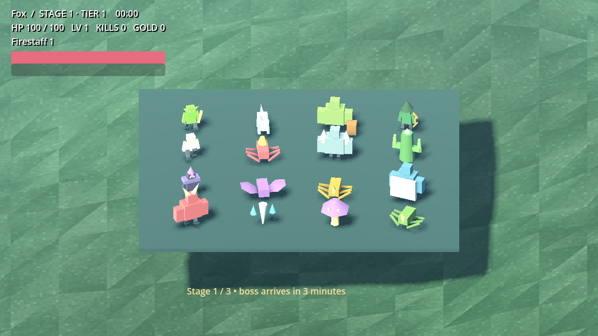

# MegaClonk

**BONK INFINITY** is an offline native Godot 4.7.2 survival roguelike. This milestone adds Ctrl crouching and physical momentum sliding, an animated original Fox Scout, and two mechanically distinct variations for all eight regular enemy archetypes. All 36 existing weapons, stages, upgrades and progression remain available. The larger specification is still in development.

## Download and play — no development tools required

1. Open [Windows build runs](https://github.com/Hazmire/MegaClonk/actions/workflows/windows-build.yml?query=branch%3Abonk-movement-overhaul).
2. Select the latest successful run for `bonk-movement-overhaul`.
3. Under **Artifacts**, download **BONK_INFINITY-Windows-x64**. GitHub requires signing in to download Actions artifacts.
4. Extract the downloaded ZIP and run **BONK_INFINITY.exe**. If Vulkan is unavailable, run **Launch_Compatibility.bat** instead.

A durable [repository ZIP](https://github.com/Hazmire/MegaClonk/raw/refs/heads/bonk-movement-overhaul/releases/BONK_INFINITY_Windows_x64.zip) is also kept in `releases/`; its exact source commit is recorded in `releases/BUILD_INFO.md`. Actions artifacts expire after 30 days. Windows builds are unsigned and native Windows playtesting remains outstanding.

WASD move, mouse look, Space jump, **Left Ctrl crouch/slide**, E interact, Escape pause, Tab inspect, wheel zoom, F11 fullscreen. Rebind controls in Settings. Crouching respects ceilings; sliding preserves momentum and reacts to slopes. There is no sprint mechanic. See [playtest instructions](docs/PLAYTEST.md).

## What changed

- Separate animated Fox Scout rig with blended idle/run/turn/jump/fall/crouch/slide/hit/death poses. Other characters currently reuse this rig; individual art remains future work.
- Sixteen independently generated enemy meshes and shared modular AI: melee, charges, ranged arrows/fans, stationary cactus attacks, flying enemies, slams, proximity and death explosions.
- Eight independent 50/50 choices made once at run start, stored by seed and preserved through stages and run save/resume.
- Instanced enemy rendering, distant merged geometry, pooled projectiles/trails/sparks, recognizable attack meshes, lightning/slashes and status feedback.
- Seeded terrain retained; ground-grain shader, grass/bushes, rocks, ruin columns, static prop collision and enemy obstacle steering added.



## Development

Open `project.godot` in Godot 4.7.2. Forward+ is the default renderer; `--rendering-method gl_compatibility` selects compatibility rendering.

```sh
cd /workspace/MegaClonk
python3 tools/install_engine.py
tools/validate.sh
tools/godot.sh --path .
tools/export.sh
```

On another Linux checkout or CI runner, set `BONK_TOOLS_ROOT` and `BONK_RUNTIME_ROOT` to writable directories before installation. The installer downloads official pinned engine/templates and verifies SHA512 digests. No account or network connection is needed by the exported game. The Actions workflow imports committed resources, runs both test suites, exports Windows x64 and uploads the playable artifact.

Architecture: `controller.gd` owns movement/camera; `scout_visual.gd` owns model poses; `enemy_catalog.gd`, `run_variants.gd`, `enemy_simulation.gd`, `enemy_view.gd` separate content, run choices, AI and rendering. Existing combat/progression remain in `game.gd`, `catalog.gd`, `progress.gd` and `mesh_pool.gd`.

[TODO and milestone status](TODO.md) · [Validation evidence](VALIDATION.md) · [Art pipeline](docs/ART_PIPELINE.md) · [Research](RESEARCH.md) · [Asset credits](ASSET_CREDITS.md) · [Remaining limits](docs/STATUS.md)
