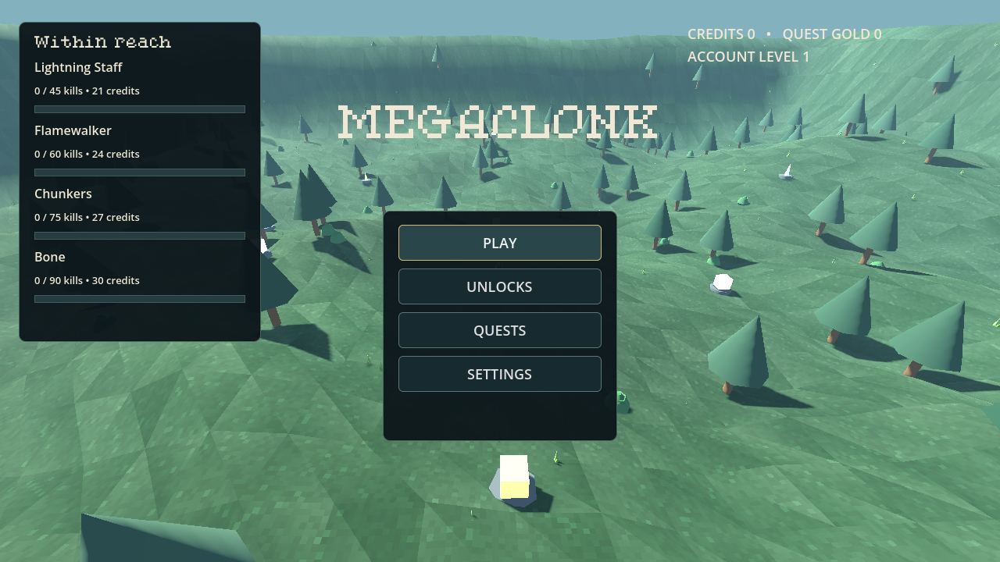
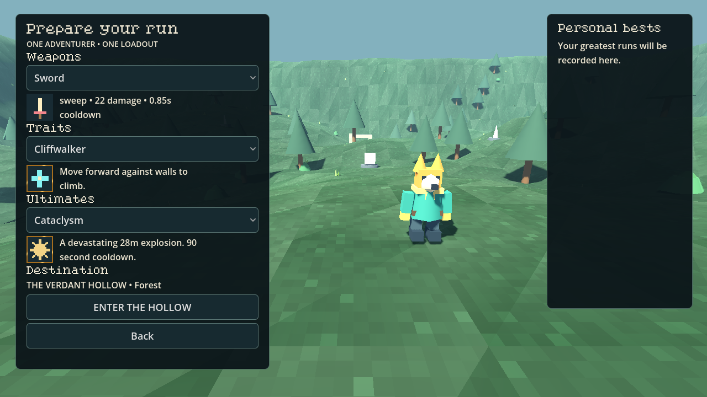

# MEGACLONK

An offline native Godot 4.7.2 3D survival roguelike. This update rebuilds the menus, loadout selection and HUD, adds traits/ultimates, quests, collection management and permanent slot upgrades, and focuses play on one cliff-bounded forest.

**Asset integration is incomplete:** the requested itch.io pages are network-blocked. Jacob, Kurland and the exact requested packs are not imported. The functional build uses one original Scout, original temporary icons/environment/audio and a verified CC0 GGBotNet heading font. [Exact asset status and required access](docs/ASSET_ACCESS.md).

## Download and play

- [Download Windows ZIP directly](https://github.com/Hazmire/MegaClonk/raw/refs/heads/megaclonk-menu-loadouts/releases/BONK_INFINITY_Windows_x64.zip)
- [Successful Actions build and artifact](https://github.com/Hazmire/MegaClonk/actions/runs/39995928415)
- [PR #3 — merge into Full-Release](https://github.com/Hazmire/MegaClonk/pull/3)

Extract and launch **BONK_INFINITY.exe**. If Vulkan is unavailable, run **Launch_Compatibility.bat**. The executable filename and `BONK INFINITY` user-data folder are retained to preserve saves; the window/menu title is MEGACLONK. No engine, account or network is needed to play. Native Windows playtesting remains outstanding. Actions artifact downloads require GitHub sign-in and expire after 30 days; the repository ZIP is retained separately with provenance/checksums in [BUILD_INFO](releases/BUILD_INFO.md).

## Play

Four main buttons: Play, Unlocks, Quests, Settings. Choose one starting weapon, one trait and one ultimate. Twelve quests award claimable credits and quest gold; account levels and gold buy permanent capacity from two weapon/tome slots to four. Collection toggles control run offers without preventing owned starting weapons from being selected. The minimap reveals exploration, and enemies grow stronger after the countdown reaches zero.

WASD movement · mouse camera · Space jump · Ctrl crouch/slide · E interact · **Q ultimate** · Escape pause · Tab stats/items/build · wheel zoom · F11 fullscreen. Gameplay keys are rebindable. [Full playtest guide](docs/PLAYTEST.md).




## Development and evidence

```sh
python3 tools/install_engine.py
tools/validate.sh
tools/godot.sh --path .
tools/export.sh
```

The engine remains 4.7.2 with Forward+ and a compatibility option. On other Linux machines/CI, set writable `BONK_TOOLS_ROOT` and `BONK_RUNTIME_ROOT`. The installer verifies official engine/template SHA512 checksums. Actions imports committed resources, runs all three suites, exports Windows x64 and uploads the playable artifact.

The previous 108 checks and 55 new menu/progression/loadout checks pass. Rendered menus, HUD, shop, inventory and upgrade screens were inspected. Exported-resource validation is separate from native Windows testing. See [VALIDATION](VALIDATION.md).

New modules: `scripts/ui/front_end.gd`, `minimap.gd`, `ui_assets.gd`; `scripts/meta/loadout_catalog.gd`, `loadout_runtime.gd`, `meta_progress.gd`. Existing combat, movement, enemy variation and pooling remain in place. Profiles migrate to V2 with a V1 backup.

[Rules and migration](docs/MENU_UPDATE.md) · [Current limits](docs/STATUS.md) · [Asset credits](ASSET_CREDITS.md) · [TODO](TODO_MENU.md)
