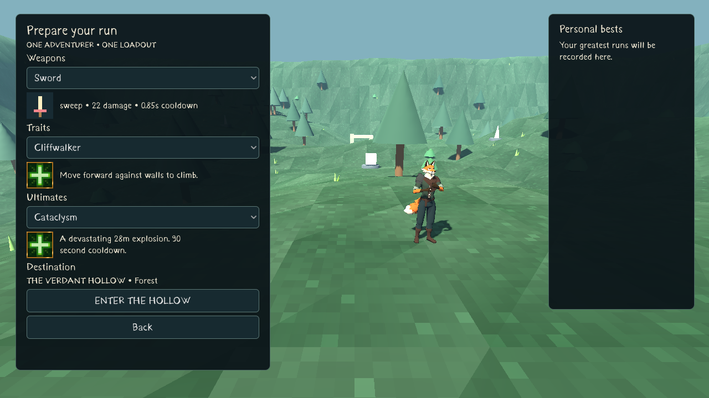
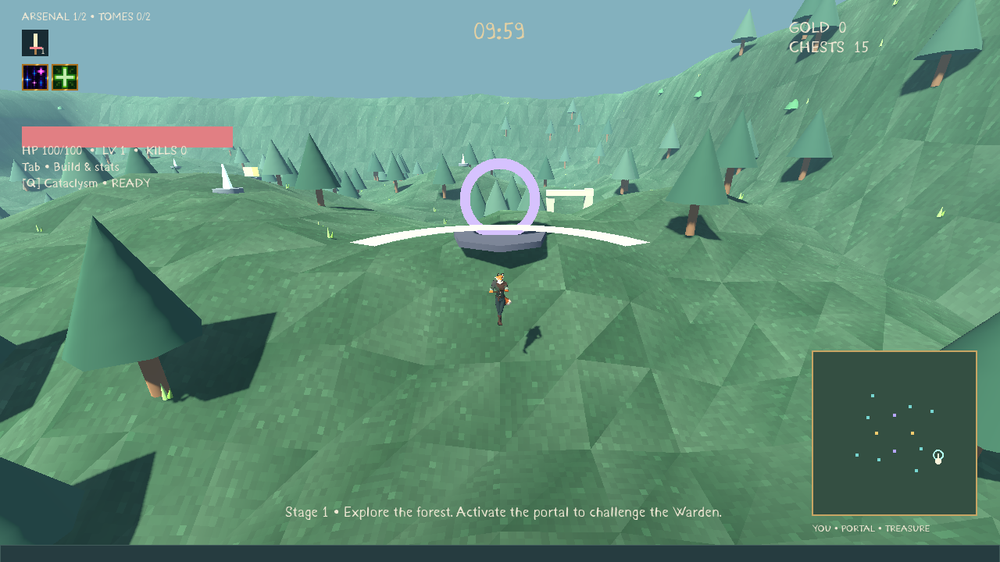

# MEGACLONK

An offline native Godot 4.7.2 3D survival roguelike. The current update delivers the **stage-loop foundation**: ten-minute stages, saved timed rushes, a player-activated boss portal, continued forest stages, tighter movement, and the supplied Jacob character, Kurland font and ability demo icons.

The larger overhaul is in progress. The two new bosses, real miniboss encounters, endless ghosts, new terrain generation, silver economy and attribute-based weapon upgrades are **not implemented yet**. [Exact milestone status](TODO_STAGE_LOOP.md) · [Supplied asset audit](docs/ASSET_ACCESS.md).

## Download and play

- [Download Windows ZIP directly](https://github.com/Hazmire/MegaClonk/raw/refs/heads/megaclonk-menu-loadouts/releases/BONK_INFINITY_Windows_x64.zip)
- [Successful Actions build and artifact](https://github.com/Hazmire/MegaClonk/actions/workflows/windows-build.yml?query=branch%3Amegaclonk-menu-loadouts)
- [PR #3 — merge into Full-Release](https://github.com/Hazmire/MegaClonk/pull/3)

Extract and launch **BONK_INFINITY.exe**. If Vulkan is unavailable, run **Launch_Compatibility.bat**. The executable filename and `BONK INFINITY` user-data folder are retained to preserve saves; the window/menu title is MEGACLONK. No engine, account or network is needed to play. Native Windows playtesting remains outstanding. Actions artifact downloads require GitHub sign-in and expire after 30 days; the repository ZIP is retained separately with provenance/checksums in [BUILD_INFO](releases/BUILD_INFO.md).

## Play

Each stage begins at **10:00**. Find the purple portal and press E to summon the existing Warden whenever you choose. Killing it opens the exit without ending the stage. Enter the mint portal to advance to a freshly seeded, harder forest while preserving your build and gold. Rushes increase pressure at 08:00 and 04:00; zero begins escalating endless pressure. Dedicated endless ghosts and 07:00/03:00 miniboss encounters are pending. [Stage rules](docs/STAGE_FOUNDATION.md).

Four main buttons: Play, Unlocks, Quests, Settings. Choose one starting weapon, one trait and one ultimate. Twelve quests award claimable credits and quest gold; account levels and gold buy permanent capacity from two weapon/tome slots to four. Collection toggles control run offers without preventing owned starting weapons from being selected. The minimap reveals exploration, and enemies grow stronger after the countdown reaches zero.

WASD movement · mouse camera · Space jump · Ctrl crouch/slide · E interact · **Q ultimate** · Escape pause · Tab stats/items/build · wheel zoom · F11 fullscreen. Gameplay keys are rebindable. [Full playtest guide](docs/PLAYTEST.md).





## Development and evidence

```sh
python3 tools/install_engine.py
tools/validate.sh
tools/godot.sh --path .
tools/export.sh
```

The engine remains 4.7.2 with Forward+ and a compatibility option. On other Linux machines/CI, set writable `BONK_TOOLS_ROOT` and `BONK_RUNTIME_ROOT`. The installer verifies official engine/template SHA512 checksums. Actions imports committed resources, runs all four suites, exports Windows x64 and uploads the playable artifact.

Baseline: 163 checks. The foundation adds 38 stage-loop checks and one changed boss-interaction regression check (202 total). Rendered menus, HUD, shop, inventory and upgrade screens were inspected. Exported-resource validation is separate from native Windows testing. See [VALIDATION](VALIDATION.md).

New modules: `scripts/ui/front_end.gd`, `minimap.gd`, `ui_assets.gd`; `scripts/meta/loadout_catalog.gd`, `loadout_runtime.gd`, `meta_progress.gd`. Existing combat, movement, enemy variation and pooling remain in place. Profiles migrate to V2 with a V1 backup.

[Rules and migration](docs/MENU_UPDATE.md) · [Current limits](docs/STATUS.md) · [Asset credits](ASSET_CREDITS.md) · [TODO](TODO_MENU.md)
