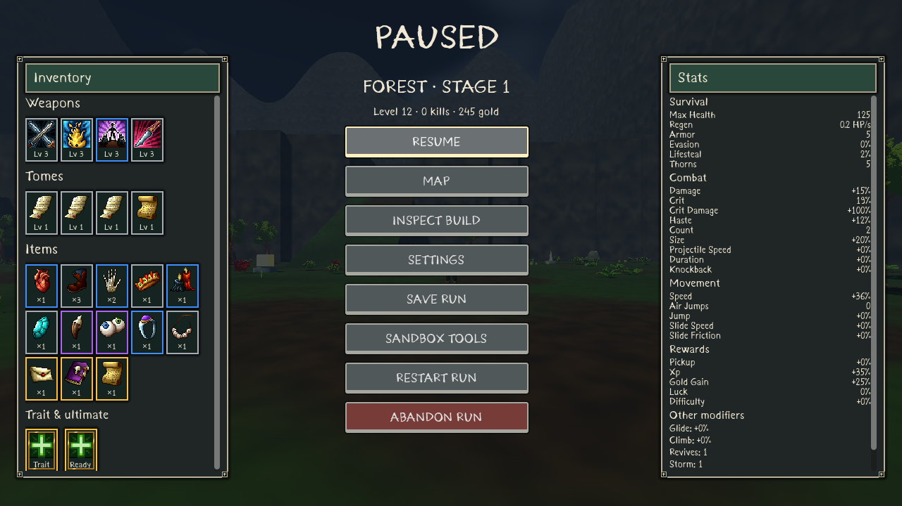
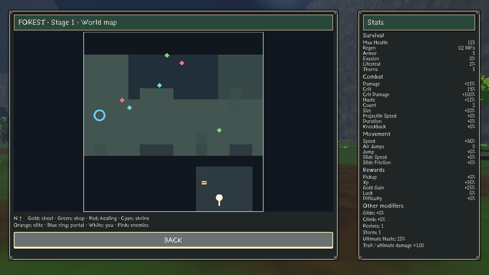

# UI refinement from the five GitHub references

The five screenshots uploaded in commit `fc17e6b` are used as layout and styling references:

| Reference | Implemented interpretation |
| --- | --- |
| `Megabonk_SCORBM51p2.png` | Large PAUSED title, central action stack, live inventory left and stats right over a dimmed world |
| `Megabonk_XzHlSrLO43.png` | Three stacked rarity cards; gold level progression at the upper right; red Banish, green Skip and blue Refresh buttons |
| `Megabonk_eTG3CY5jPi.jpg` | Large discovered-world map with stats sidebar, distinct landmark markers and preserved fog of war |
| `Megabonk_vxDEAq9rbQ.jpg` | Shared framed inventory/stats, large rarity reveal and bevelled blue Continue button |
| `firefox_WjCOcSAmyE.png` | Framed shop cards with gold prices at the upper right, ownership below descriptions and a clear Leave action |

Original project fonts, icons, procedural frames and code remain the game assets. The reference screenshots are excluded from both Windows and Linux exports; the compiled-pack smoke explicitly checks that they are absent.

## Pause and map

Escape opens the redesigned pause screen. Resume, inspect build, settings, save, restart, abandon and sandbox tools retain their existing behaviour. The Map button opens a larger map and returns to pause with Escape or Back. From gameplay, the rebindable **M** action opens the map; Escape or M then resumes gameplay. Settings exposes the map binding through the existing input configuration.

The map shares explored cells and the reveal-all trait with the HUD minimap. It reveals the player's current surroundings, preserves the world's aspect ratio, shades discovered terrain by sampled elevation and differentiates chests, shops, healing, shrines, elites, enemies and the boss portal. Height colours are cached per stage. It adds no exploration rewards or combat effects. The normal game simulation remains paused while inspecting it.

Empty and locked weapon/tome slots now show available capacity. Card rarity, real progression, ownership and prices still come from the existing gameplay registry; the references do not change rarity assignments, balance, purchase rules or rewards.

## Verification

All fifteen regression suites pass locally (633 named assertions plus seeded-world reports). The focused reward/UI suite now contains 27 checks, including pause/map entry, fog retention, map aspect, paused simulation, rebindable input, Escape returning to the correct state and normal resume. The export smoke exercises pause, map and all reward screens from compiled game data. Rendered captures cover 720p, 1080p and 1440p. A representative explored route is set up only in the visual fixture; real runs retain normal exploration.

Linux Godot validates exported resources and Mesa renders the UI; native Windows execution, physical controllers and gaming-GPU frame rates still require playtesting. The documented Mesa sky-texture shutdown warning remains. See REWARD_UI.md for the preceding reward/XP implementation and performance limits.
