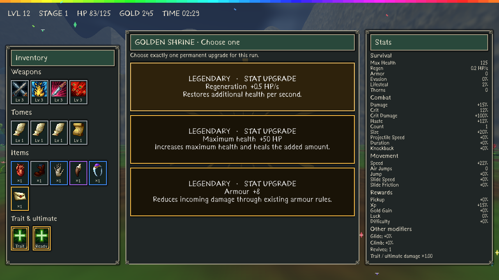
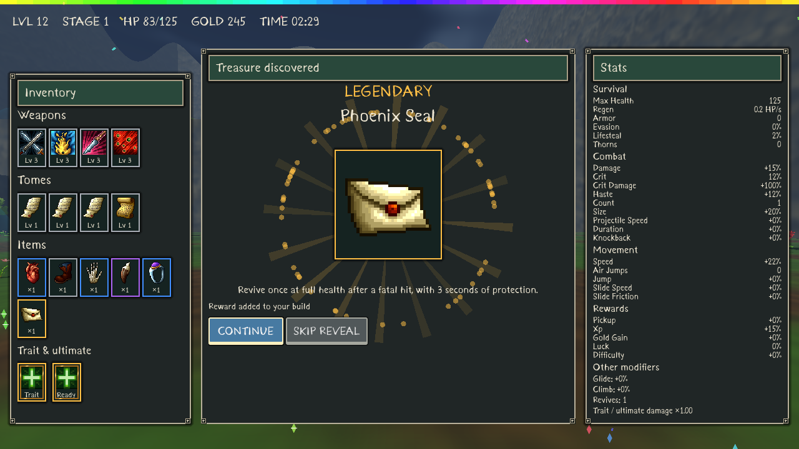
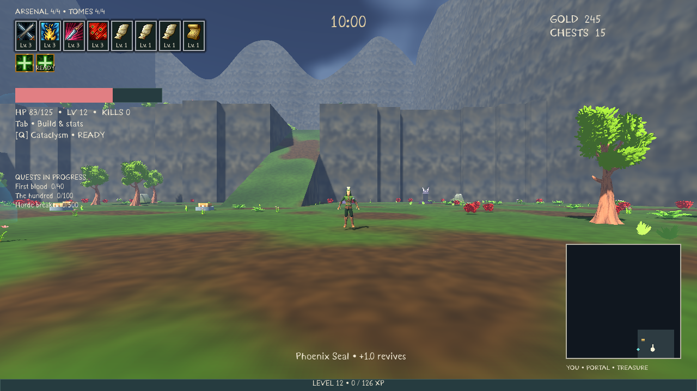

# Shrine choices, continuous pursuit and reward presentation

This increment supersedes the v8 shrine and chest presentation rules. Godot remains 4.7.2. Existing terrain, stage palettes, object minimums, crowd collisions, boss multipliers, rarity registry, queued chest drops and progression remain in place.

## Gameplay changes

Shrines charge automatically within their visible 5m sphere for 8 accumulated seconds. Outside the sphere they lose **15 percentage points per second**, down to zero. Completing a shrine marks it used immediately, pauses gameplay and offers three fixed stat cards. Choose one; only that bonus is applied. A checkpoint preserves pending choices, their rarities and the shrine queue. Old completed shrines retain their already granted reward and cannot be reused.

Each shrine placement independently has a seeded **2%** Golden Shrine chance. There is no per-map guarantee. Golden shrines have gold geometry, an illuminated gold orb, a limited shared-mesh particle emitter and a larger gold completion pulse. All three choices are already Legendary before selection. Normal shrine tiers use the existing 50/28/14/6/2 weights without luck modification. Distinct eligible stats are drawn without replacement; if fewer than three valid stats exist, only those valid choices appear. If none exist, the screen explains this and offers Continue. Capped critical chance cannot exceed 100%.

The central balancing table is `assets/config/stat_rewards.tres`; charging, decay and gold probability are in `assets/config/stage_update.tres`.

| Stat | Common | Uncommon | Rare | Epic | Legendary |
| --- | ---: | ---: | ---: | ---: | ---: |
| Damage | +5% | +8% | +12% | +18% | +25% |
| Movement speed | +3% | +5% | +7% | +10% | +14% |
| Maximum health | +10 | +16 | +24 | +36 | +50 |
| Critical chance | +2pp | +3pp | +5pp | +7pp | +10pp |
| Attack speed | +4% | +6% | +9% | +13% | +18% |
| Pickup radius | +10% | +16% | +24% | +36% | +50% |
| XP gain | +5% | +8% | +12% | +18% | +25% |
| Armour | +1 | +2 | +3 | +5 | +8 |
| Regeneration, HP/s | +0.10 | +0.16 | +0.24 | +0.36 | +0.50 |

Percentage multiplier bonuses add to the existing base multiplier, rather than compounding the current value. Critical chance adds percentage points. A reward near a cap displays the actual remaining bonus. Maximum health also heals the added amount. Cards have text and rarity accents, without item icons.

Chests show one central item icon that changes rapidly and slows over 3.5 seconds. The reward is fixed and granted once through the existing reward queue before the animation starts. Cycling uses only eligible existing icons and never consumes gameplay RNG. Skip Reveal, or Escape during the animation, fast-forwards to that same item. Continue acknowledges the reveal. The same presentation serves paid chests, rare free chests and all enemy/boss drops. Queued rewards and already granted active rewards remain compatible with checkpoints.

Level-up, shrine and chest screens use continuously recycled confetti/gem draw particles behind important text. Local rays and rarity bursts sit above the central frame background and behind its content. Pools are bounded; they create no individual particle nodes per frame. Closing a screen fades its celebration for 0.4 seconds. Existing reduced-effects/intensity and audio settings apply. Original synthesized applause, a coin impact and the existing level sound accompany reveals; Legendary adds an original four-note flourish. These are synthesized effects, not a claimed recording of a real crowd.

Ordinary melee enemies pursue continuously and use the independent 0.75s contact-damage clock. They never begin normal melee wind-up/recovery; old saved melee poses are repaired. Exploding Bugs, projectile/charge abilities and boss specials retain their explicit special behavior. Existing crowd obstruction, support, ramps and cliff drops still apply.

The top-left equipment HUD places owned weapons and tomes in one compact horizontal row, with icons, rarity borders and levels. Empty slots are omitted. Trait/ultimate badges remain below it. The HUD reads the existing inventory, refreshing after acquisition, upgrades, reset and load. The left quest tracker lists only active quests, using permanent progress plus the current run's live progress. Completed/unclaimed and claimed entries stay in the quest menu. Claims update the existing button and wallet without rebuilding tabs or scroll containers.

The minimap and expanded map read the active camera's world forward vector projected onto X/Z. Avatar direction, backwards movement and strafing do not affect the arrow. The map itself remains north-up. Pitch does not rotate the arrow; at a vertical singularity it retains the previous valid horizontal direction.

## Bug causes and fixes

- XP attraction: `update_pickups` explicitly forced attraction whenever gem age exceeded 25 seconds. This was independent of distance. Removed that condition, retained the existing `5 × pickup` radius, and added a latched attraction state with reason/distance/radius diagnostics. Once validly attracted, a gem continues following. Fresh pooled gem records reset that state, saved attraction survives load, and new drops no longer merge into an already moving gem.
- Completed quest display: the closest-progress list treated every unclaimed quest as active, including completed/unclaimed entries. The inspected gameplay HUD had no explicit active-only tracker. Added active/completed/claimed state queries and a live gameplay tracker, and excluded completed entries from the closest-progress list.
- Claim tab reset: the callback called `quests()` again, replacing the whole TabContainer. Claims now update in place, preserving the actual category and scroll objects.
- Enemy pauses: standard melee still called the wind-up/recovery attack state machine even though contact damage had become independent. Normal melee entry is now disabled for non-boss enemies.
- Map arrow: its direction came from `avatar.rotation.y`; it now comes from the active gameplay camera's global basis.

## Validation and delivery status

All 23 local suites passed: 859 named checks, including 95 new focused checks, plus the existing seeded terrain/decoration/object audits. Golden Shrine sampling produced **1,986 of 100,000 placements (1.986%)**. Each normal rarity weight, all 45 stat/tier bonuses, near-cap and insufficient-stat cases, saved fixed choices, stale input across queued shrines, continuous pursuit/contact and live HUD/map/quest behavior passed. Natural 3.5-second and skipped icon reveals preserve reward RNG and never grant again. Particle pool tests advance fifteen seconds without stopping or growing.

The final local regression rerun also passed all 859 assertions. Source and compiled Windows game resources were rendered and viewed, including normal/Golden shrine cards, central chest reveal, persistent level-up confetti and horizontal HUD at 720p/1080p/1440p. The fifteen source captures are in [the preview directory](images/rewards-v9). The local clean Windows export passed compiled world, UI, stage/swarms and v9 smoke gates. [The v9 Windows ZIP](https://github.com/Hazmire/MegaClonk/releases/download/shrine-rewards-v9/BONK_INFINITY_Windows_x64.zip) is published. The actual downloaded ZIP matched GitHub size/digest and passed every archive CRC. Its BUILD_INFO confirms clean source ea6c26f; the downloaded embedded pack passed a 180-frame world run and the reward/UI, stage/swarms and v9 gates without script/resource errors. [Publishing workflow](https://github.com/Hazmire/MegaClonk/actions/runs/40544084785) and [PR #4](https://github.com/Hazmire/MegaClonk/pull/4). Merge PR #4 into Full-Release to update the default branch; downloading does not require merging.

## Performance observations

The workspace host restarted during development. The following v8 baseline and final v9 samples were measured sequentially on that replacement host, with rendering excluded. Shared-host scheduling varies; these do not establish gaming-PC FPS or isolate every cause of the difference. Both versions exceed the 16.67ms full-frame CPU budget at 500 enemies, and this update does not resolve that limitation.

| Enemies | v8 CPU mean | v9 CPU mean / worst |
| --- | ---: | ---: |
| 50 | 2.86 ms | 3.20 / 7.04 ms |
| 100 | 5.84 ms | 8.00 / 23.57 ms |
| 250 | 17.26 ms | 19.86 / 40.25 ms |
| 500 | 35.02 ms | 38.55 / 48.31 ms |

The v9 500-enemy CPU mean is about 10% higher than the same-host v8 sample. Eight bosses plus fifteen owned minions averaged 1.40ms CPU, worst 5.73ms. Twenty-five simultaneous death/drop events averaged 0.047ms; collecting all twenty-five and opening the first reveal took 33.62ms. The 1,000-gem test averaged 1.25ms per update; opening a chest overlay averaged 19.81ms and a level-up overlay 32.32ms including headless frame processing. These UI openings can hitch. The confetti uses fixed draw-particle arrays rather than per-particle nodes. Raw reports are in releases/REWARDS_V9_*.json.

The known software-Mesa sky-texture shutdown diagnostic remains; no new script/shader/resource errors appeared in rendered captures. Audio assets and playback scheduling were exercised, but audible output is unverified.

## Modified systems

| System | Main files |
| --- | --- |
| XP lifecycle, modal/save queues and audio | scripts/core/game.gd |
| Shrine generation, charging, reward data | scripts/world/shrine_charging.gd, scripts/rewards/shrine_rewards.gd, assets/config/stat_rewards.tres, stage_update.tres |
| Continuous pursuit | scripts/enemies/enemy_simulation.gd |
| Quest states and live progress | scripts/meta/meta_progress.gd, scripts/ui/front_end.gd |
| Reward screens, particles and equipment HUD | scripts/ui/reward_screens.gd, reward_celebration.gd, front_end.gd |
| Camera-facing map | scripts/ui/minimap.gd |
| Regression, rendered fixtures and compiled gates | tests/rewards_ai_v9.gd, rewards_v9_visual.gd, tools/export_v9_smoke.gd |

 No native Windows execution, audible audio or gaming-GPU 60FPS claim is made by headless Linux pack validation.
