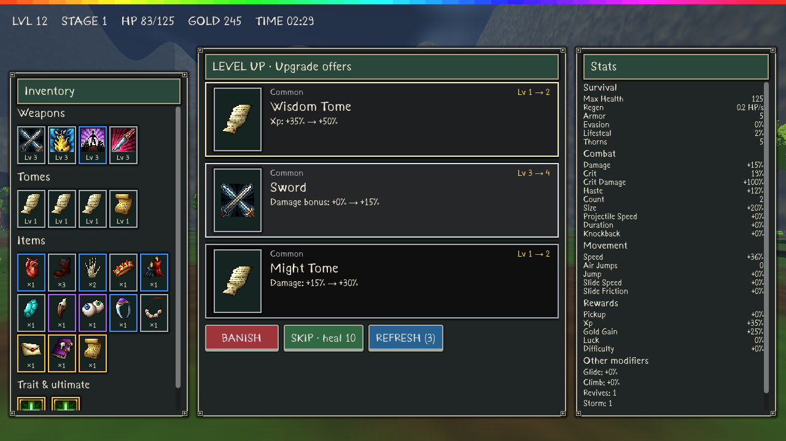
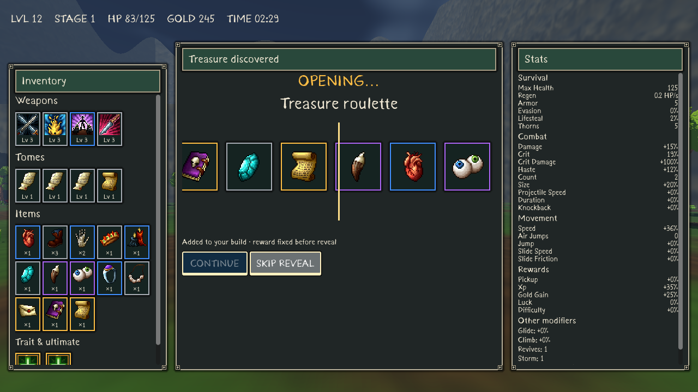
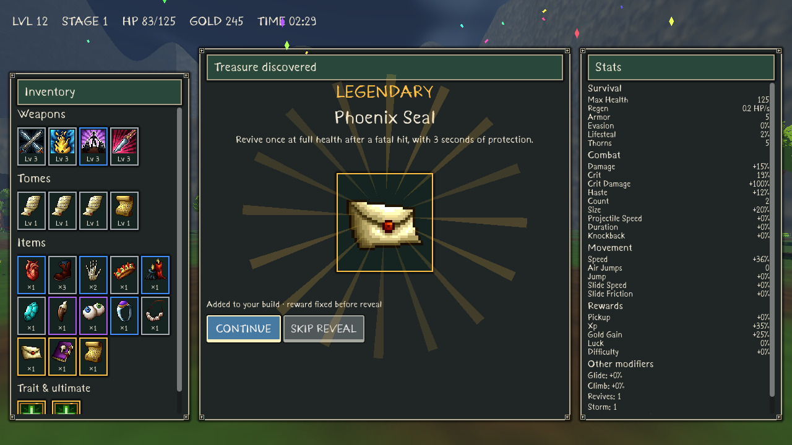
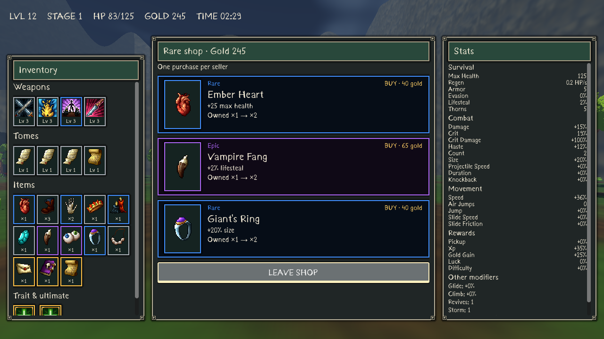
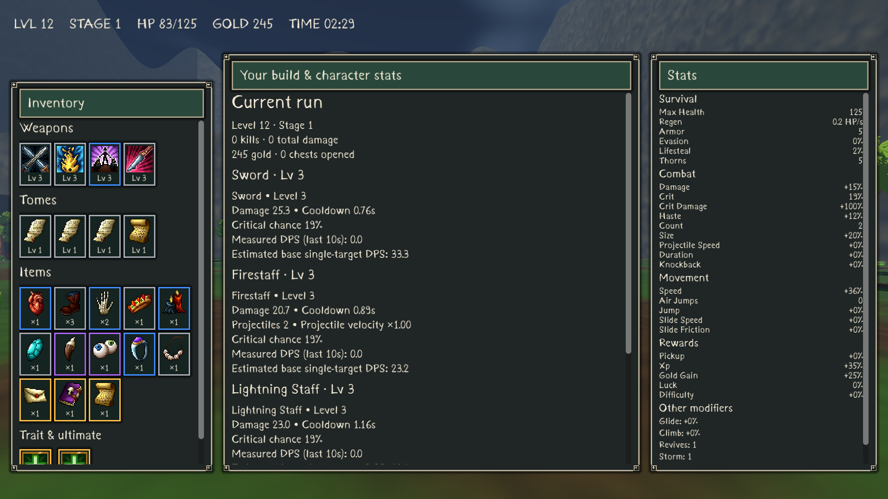

# Reward interfaces and XP gemstones

This increment implements Milestones 5–10 of the rarity/world specification. The supplied screenshots inform the composition: framed inventory left, reward/build content centre and live statistics right. It uses existing licensed icons and Kurland, original frames and original procedural effects. No reference-game artwork is copied.

## Screens

- Level-up: three vertical, rarity-bordered cards with icons, descriptions, actual current/next levels and upgrade effects. Focus/hover highlights, rainbow strip, confetti and flying gems animate while gameplay pauses. Banish applies to the focused offer; skip and refresh preserve existing mechanics and reroll limits.
- Treasure: scrolling icons slow onto the preselected item; rarity changes the reveal colour and celebration strength. Tick sounds accompany the reel. Continue and Skip Reveal never award another item: existing gameplay awards it before opening this screen. Reduced-effects settings reveal it immediately.
- Shop: shared cards show real gold, prices, rarity, descriptions and current ownership. Sold, disabled, unavailable and unaffordable offers cannot be purchased. Existing one-purchase seller behaviour and prices remain unchanged.
- Build: live weapon/tome levels, item stack counts and rarities, selected trait/ultimate, effective stats, run information and weapon breakdowns. Longer lists scroll; tooltips provide detail.

The authoritative registry still uses Common grey, Uncommon green, Rare blue, Epic purple and Legendary gold. Upgrade level is independent of rarity. This intentionally follows the project specification even where reference screenshots use different tier colours.

## XP and saves

Blue pickups share one faceted gemstone mesh/material, rotate and bob gently. The specular surface catches the light as it turns. Existing magnet, merging and full XP value are preserved. Shadows are disabled and distant gems are culled at 65m. Pools prewarm 128 blue and eight red instances.

An independent seeded RNG rolls a 0.25% red-gem chance per eligible ordinary death; summons, no-reward entities and bosses are excluded. Red gems remain separate from merged blue XP. Each grants exactly one level, preserving the fractional progress toward the next level regardless of XP multipliers. Normal threshold overflow is processed before the red level. Multiple earned upgrades queue and remain paused until resolved.

Run saves retain red/blue types, gem RNG state and pending choices, including an open choice. Older version-2 checkpoints without these fields load with compatible defaults. The gem RNG does not consume combat/reward RNG values.

## Validation and limits

`tools/validate.sh` includes fifteen regression suites. `tests/reward_ui.gd` covers 19 checks: eligibility, 100,000 red rolls (240 drops, 0.24%), exact-level progress, pooling/merging, save/load, three stacked cards, duplicate protection, affordability, resolution bounds and synthetic UI navigation/accept inputs.

`tests/reference_ui_visual.gd` captures actual rendered screens at 1280×720, 1920×1080 and 2560×1440. These were visually inspected using Mesa software OpenGL. Synthetic controller actions validate focus navigation; physical controller hardware is untested.

UI celebrations use at most 32 simple drawn particles, with three-second confetti lifetimes. Reel icons are bounded to 27; animation uses a visual sequence and cannot reroll gameplay rewards. Hidden celebrations stop processing and modal changes cancel reveal tweens before freeing controls. Reduced-effects settings suppress celebrations. No new per-gem particle emitter or physics body is introduced.

Windows export rejects script/resource errors from both a 120-frame world smoke and an explicit reward-screen smoke against the compiled embedded pack. Linux Godot can validate those resources; this does not execute native Windows code. Gaming-GPU 60FPS, physical controller and audible audio remain unverified. Mesa retains a known sky-texture shutdown diagnostic; see VERTICAL_PERFORMANCE.md for world performance and remaining renderer limits.

### Recorded CPU measurements

Local headless run: all fifteen suites passed (625 named assertions, plus deterministic seed/collision/traversal reports). The 400-enemy integration benchmark averaged 7.96ms/tick; dynamic spatial/combat simulation averaged 9.01ms/tick. These are CPU timings and exclude rendering.

`tools/reward_profile.gd` tested 1,000 deliberately unmerged gems: 0.775ms/update averaged over 120 ticks. Creating all 1,000 at once took 92.4ms, a stress burst rather than the ordinary merged drop path. Twenty modal rebuilds averaged 13.12ms for upgrades and 7.28ms for roulette, including one headless process frame each. Timings share a cloud host and are not frame-rate guarantees. Existing spatial XP merging and prewarming remain important; a very large single burst can still hitch.

Verified Windows playtest: [Rewards and XP v7](https://github.com/Hazmire/MegaClonk/releases/download/rewards-ui-v7/BONK_INFINITY_Windows_x64.zip), clean source `9b762af6659b0b0d12be99e35e62543afe6ee983`. CI passed all fifteen suites and both compiled-pack gates; the downloaded ZIP also passed SHA256, archive CRC, source, 180-frame world and reward-screen checks. See [publication evidence](../releases/BUILD_INFO.md).
