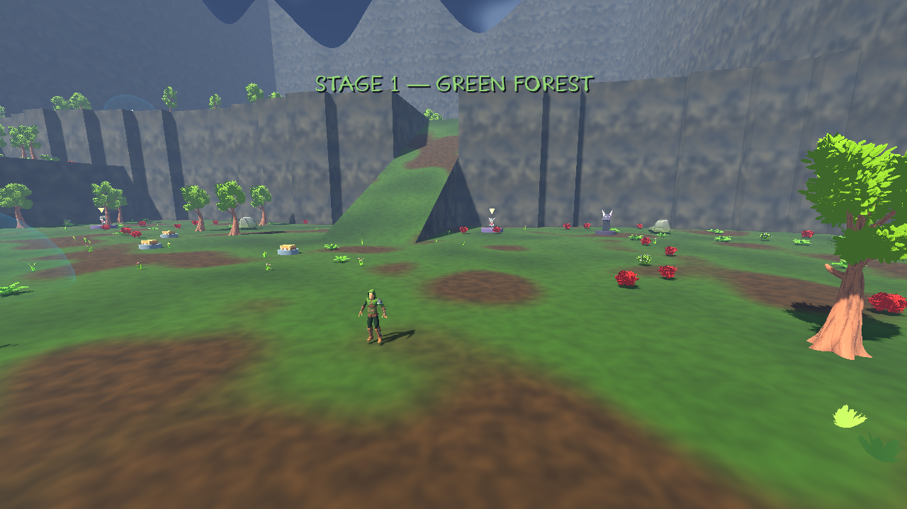
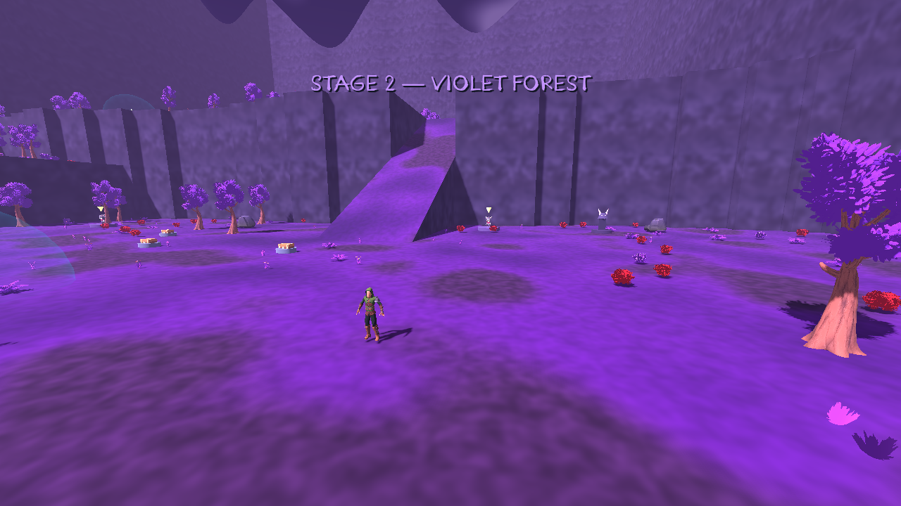
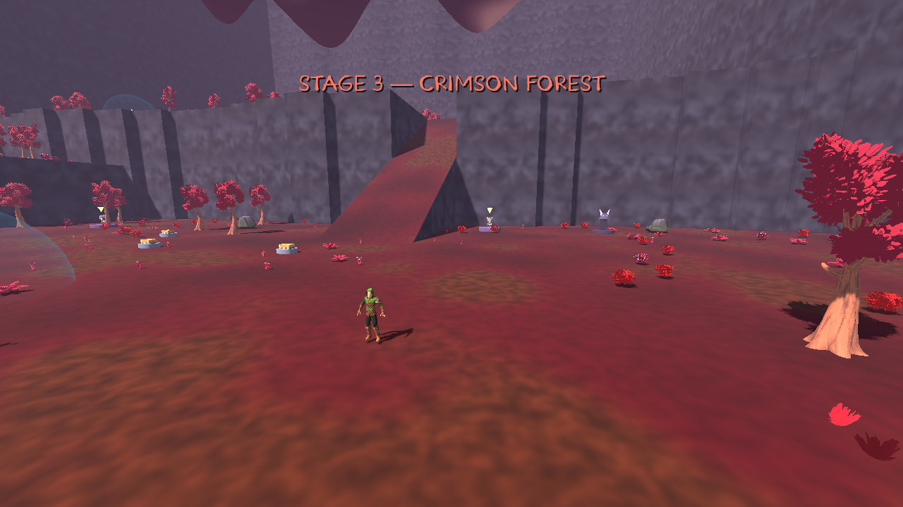

# Stage themes, physical swarms, shrines and multiplied bosses

This increment extends the existing Godot 4.7.2 project. Start a new run to generate the expanded exploration layout. Older checkpoints retain their saved terrain and object layout until the next stage.

## Playtest changes

- Stages cycle through green, violet and crimson forest palettes. Ground, grass, leaf pixels, rocks, sky and fog use actual shared material settings. A brief animated stage title appears once on entering each stage, never again after loading that stage.
- Ordinary enemies deal contact damage on an independent 0.75-second interval. Existing armour, evasion, invulnerability, Ghost form, thorns and red hit feedback apply. Exploding Bugs use their telegraphed explosion instead of double-dipping contact damage.
- Enemy bodies obstruct movement and one another. Supported crowds can climb over lower bodies up to 2.8 metres; unsupported bodies descend. The player cannot run through a dense swarm; Ghost form can. Existing ramp and cliff traversal remains active.
- Each elite, miniboss and stage boss drops one free touch-collected chest. Nearby chests queue their existing reward reels, including across save/load. Opening them does not raise ordinary paid-chest prices. Each reward is granted once.
- Every shrine charges automatically within 5 metres for 8 seconds. Leaving preserves progress. Its visible orb and percentage show charging; completion removes the orb, labels it COMPLETE and grants one real stat upgrade. No interaction key is needed.
- New stages contain at least 15 ordinary paid chests, 3 shops, 2 elite statues and 1 boss statue. There is an 8% seeded chance of an additional 1–5 free chests. Placements reserve safe terrain and avoid ramps and props.
- Use the existing interact binding (E by default) at the horned boss statue. It permanently adds one boss to future encounters in this run. Activating during a fight affects later encounters. The timed miniboss pool is Champion/Hunter; main bosses independently roll Chunkus/Golem. All required bosses, including pending spawns, must die before completion. Every boss has its own health, abilities and reward chest.
- Golem summons have distinct owners, a twelve-per-owner limit and a twenty-four global limit. Defeating one golem cleans only its summons. Large encounters use a bounded health display with an aggregate overflow row.

## Configuration and architecture

`assets/config/stage_update.tres` controls contact intervals, crowd limits, shrine distance/time, object counts, free-chest chance and summon capacity. `assets/themes/*.tres` hold all three palettes. Stage 4 deliberately cycles to green.

`CrowdPhysics` uses a rebuilt 3m spatial hash, packed body snapshots, bounded local contacts and alternating 30Hz collision groups; player movement and contact damage remain at the normal physics rate. It uses existing batched rendering rather than a rigid body per enemy. `BossEncounters`, `RewardDrops` and `ShrineCharging` isolate their runtime state. Saved stable enemy IDs prevent reward chest IDs being reused after load. Object-content versioning preserves old checkpoints.

## Verification and limits

All 22 regression suites pass: 761 named checks, plus 200 terrain layouts, 200 decorated worlds, 104,353 collision rays, 400 enemy traversal cases, 1,000 live interactions, 73 detailed cliff-drop cases and 200 expanded-object layouts. Both elite statues were activated and all six elite chest drops checked. The object audit found 13 of 200 seeds with free chests.

Compiled Windows game resources also passed world, reward/UI and stage/swarms smoke checks through Linux Godot. The compiled pack was rendered and viewed for all three palettes, swarm support, shrine charging/completion and three individual boss health bars. No native Windows executable execution is implied.

Actual rendered captures are in [the preview directory](images/stage-swarms). Theme palettes, a supported swarm, shrine charging/completion, boss statue, three separate boss health bars and a free reward chest were viewed. These are rendered fixtures; they do not establish prolonged human playtesting.

Performance is a known limitation. A comparable dense baseline without crowd collisions averaged 1.08/2.09/5.08/10.08ms for 50/100/250/500 enemies. The updated AI/contact/crowd/grid/FX/HUD headless sample averaged 2.04/4.45/11.81/23.99ms, with a 53.89ms worst frame at 500. Collision solving alone averaged 5.23ms at 500 in the final regression run. These are cloud-host measurements, not gaming-PC FPS. The 500-enemy full CPU result exceeds a 16.67ms frame budget and is a material regression. This release does not satisfy an unqualified 60FPS acceptance claim.

| Enemies | Baseline CPU mean | Updated CPU mean / worst | Software-rendered frame mean |
| --- | ---: | ---: | ---: |
| 50 | 1.08 ms | 2.04 / 3.66 ms | 214.19 ms |
| 100 | 2.09 ms | 4.45 / 6.06 ms | 275.11 ms |
| 250 | 5.07 ms | 11.81 / 21.13 ms | 444.82 ms |
| 500 | 10.08 ms | 23.99 / 53.89 ms | 736.69 ms |

The final headless sample also measured 25 simultaneous death/drop events at 0.04ms mean, but collecting all 25 and opening the first reel took 26.22ms. Software Mesa rendering is substantially slower than real desktop GPU rendering. The known Mesa sky-texture shutdown diagnostic remains. Native Windows execution, audible audio and gaming-GPU performance are unverified. See `releases/STAGE_SWARMS_*` reports for raw measurements and publication status.

## Build and delivery

Run `tools/validate.sh`, then `tools/export.sh`. The export embeds the game resources in the Windows executable, packages a ZIP, and runs compiled world, reward/UI and stage/swarms smoke checks through Linux Godot. These checks validate compiled resources; they do not execute Windows machine code.

The Windows workflow uploads a 30-day Actions artifact on source builds. Manual dispatch, or a source push on the active `megaclonk-menu-loadouts` development branch, publishes the distinct `stage-swarms-v8` prerelease after all validation/export gates pass. Consult README and release provenance for verified publication; a configured workflow alone does not mean a build has been uploaded.
