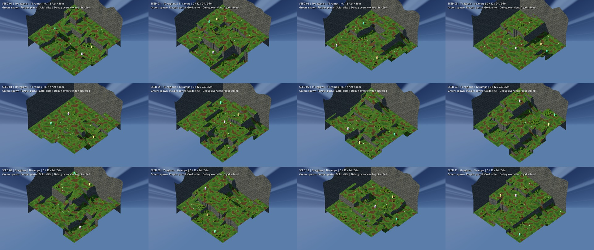
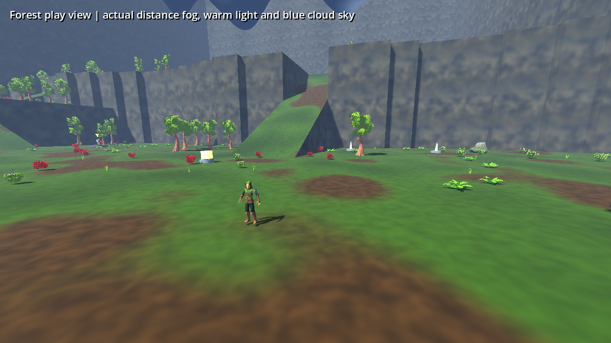
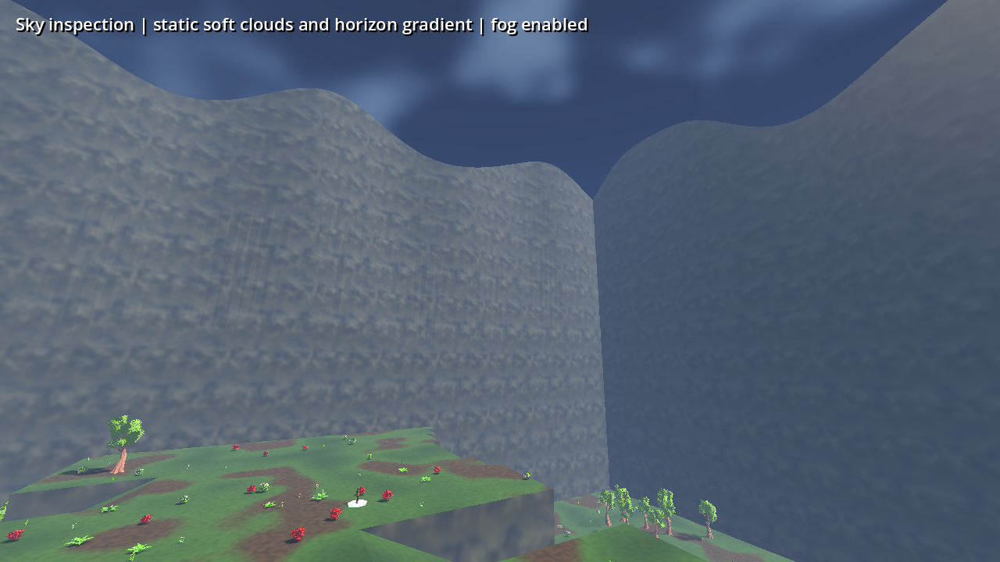

# Vertical Forest — Milestones 2–4

This increment follows the tested rarity foundation and completes the procedural terrain, atmosphere and world-placement milestones. XP gemstones and the reward-interface redesign remain pending in [TODO_RARITY_WORLD.md](../TODO_RARITY_WORLD.md).

## Terrain

`ForestRegions` uses seeded binary subdivision of the 192×192m world, favoring broad regions without a fixed row grid. It samples heights independently of distance from the centre, reserves each elevation band, and joins adjacent regions with a randomized spanning graph plus extra connections. Regions at the same height can form larger joined landmasses.

The default palette is **0 / 12 / 24 / 36m**, tripling the previous 12m range. Cell-aligned cliff notches vary one axis per seed and taper smoothly near ramp mouths. Walkable surfaces remain planar. A ramp's length grows with the height difference, rounds to four-metre increments to meet the two-metre collision grid, and preserves a straight constant slope no steeper than 28°. Ramps do not overlap. No continuous rolling-hill noise is used.

Flat cliff normals keep the ground shader's stone material separate from grass. Perimeter faces share one continuous base and crest across plateau boundaries. Their lower half stays inside the playable boundary, closing walking and airborne gaps. Default crests reach 104–136m absolute height, at least 68m above even the highest plateau. The collision mesh and rendered terrain share geometry.

### Designer controls

The existing `assets/config/forest.tres` / `ForestSettings` resource exposes:

| Control | Default |
|---|---:|
| Elevation bands / total range | 4 / 36m |
| Elevated coverage sampling target | 75% |
| Non-zero band weights | Empty: uniform; configurable array |
| Minimum plateau side / region count | 44m / 7–12 |
| Plateau split size bias | 2 |
| Preferred / maximum ramp length | 28m / 80m |
| Ramp width / maximum slope | 12m / 28° |
| Extra connections / candidate frequency | 2 / 65% |
| Cliff outline variation | 4m |
| Optional-object count range | 12–12 |

One region per band is always reserved. Coverage is a sampling target; actual area varies by seed. Larger size bias favors subdividing the largest remaining regions. Default optional-object counts preserve the existing economy: two of each of six types. Counts can be configured without changing the spawning code; varying them changes the economy and is not enabled by default.

## Atmosphere

`forest_sky.gdshader` supplies a navy zenith, blue horizon gradient, restrained warm directional haze and three-scale soft clouds. It has no TIME dependency and uses a static 128px radiance map. Warm directional lighting and ambient fill keep enemies readable. Distance fog density is 0.0045, reduced from 0.013 so distant cliffs fade without hiding normal combat range. Clouds are static, not volumetric.

## Placement

`ForestPlacement` samples flat terrain on a seeded candidate grid, excludes ramps and cliff edges, checks six-metre floor clearance, and independently shuffles candidates. Spawns come from the outer third of the map. Portals select a random eligible location at least 64m from spawn, rather than always selecting the farthest corner. Elite statues maintain separate interaction zones. Optional objects rotate through a shuffled elevation-band list, with ten-metre separation and safe spawn clearance. There is no radial placement pattern.

Scenery is generated afterward and reserves these clearings. The shared flow graph and native Godot navigation then validate access; any blocking-decoration repair is explicitly recorded. All tested worlds needed **zero repairs**. Required portal/statue locations and the twelve default optional objects are guaranteed. Existing minimap positions and interaction code use the generated transforms.

## Traversal and saves

Enemies retain climb/drop states. Taller climbs receive an appropriate bounded timeout. The terrain probe stops at nearby targets, preventing a climb toward a cliff behind the player. Gravity-based drops, collision checks and landing logic remain intact.

New saves record `terrain_version: 4`. Version-3 checkpoints retain the old generator and object placement throughout that run, preserving positions, inventories and encounter state. New runs reset to version 4. Legacy geometry constants are frozen so tuning the new generator cannot change old checkpoints. Changes to version-4 defaults require a new terrain version for checkpoint stability. Unsupported future terrain versions are rejected before changing the current world. Earlier checkpoints retain the existing safe-spawn migration.

## Evidence

All fourteen regression suites pass locally: **606 assertions**, **70 cliff-drop cases**, **200 deterministic layouts**, **200 decorated collision/navigation worlds**, **101,114 collision rays** and **1,000 real shop/chest/shrine/statue/portal interactions**, plus **400 per-world enemy climb/drop checks**. The 200 layout/physics cases use matching map seeds 0–199. Connectivity and first construction attempts passed without flattening or decoration repairs. Tests include player/enemy ramp traversal, 24m+ climbing, falling after damage, ramp landings, old/new checkpoint geometry and object-position preservation, and rejection of future terrain versions.

| Measurement across 200 seeds | Minimum | Mean | Maximum |
|---|---:|---:|---:|
| Elevation bands / range | 4 / 36m | 4 / 36m | 4 / 36m |
| Elevated surface area | 48.16% | 78.14% | 95.43% |
| Flat surface area | 83.20% | 89.58% | 95.05% |
| Flat regions | 7 | 9.21 | 12 |
| Ramps | 8 | 10.19 | 13 |

Spawn elevations: 48 low, 50 at 12m, 55 at 24m, and 47 at 36m. Every layout is structurally unique. Portal positions were unique in 190/200 worlds; elite statues in 192/200. All four height bands contain chests, shops, shrines and portals. Candidate counts range from 175 to 337 per world. Every actual object transform and height is recorded in [physics-placement-200.json](world/physics-placement-200.json); terrain measurements are in [terrain-200.json](world/terrain-200.json).

### Rendered previews

Overview captures disable fog and use an elevated debug camera to expose geometry. Colored pillars mark spawn (green), portal (purple) and elite statue (gold). These are not normal gameplay cameras. Individual 1280×720 renders: [00](images/vertical/seed_00.png), [01](images/vertical/seed_01.png), [02](images/vertical/seed_02.png), [03](images/vertical/seed_03.png), [04](images/vertical/seed_04.png), [05](images/vertical/seed_05.png), [06](images/vertical/seed_06.png), [07](images/vertical/seed_07.png), [08](images/vertical/seed_08.png), [09](images/vertical/seed_09.png), [10](images/vertical/seed_10.png), [11](images/vertical/seed_11.png).

These final two views retain normal fog. Rendering was inspected using Mesa software OpenGL. Native Windows rendering and gaming-GPU frame rate remain untested. See [performance and limitations](VERTICAL_PERFORMANCE.md).

Version 6.1 handles missing exported height weights with the same uniform default. The export script now runs the actual embedded game pack before publishing; editor validation alone did not catch the v6 initialization issue.
